<p align="center">
  
</p>

<p align="center">
  <a href="README.md">English</a> · <b>Español</b>
</p>

<p align="center">
  <a href="https://beg-lag.github.io/constitucion-viva/"></a>
  <a href="https://github.com/BEG-lag/constitucion-viva/actions/workflows/ci.yml"></a>
  <a href="LICENSE"></a>
  <a href="DATA-LICENSE.md"></a>
</p>

# constitución viva

**La Constitución de 1917, viva.** Una historia interactiva, hecha con datos, de cada
reforma a la Constitución mexicana desde 1917: qué artículos cambiaron, cuándo, con qué
presidencia y legislatura, cómo creció el texto palabra por palabra y cómo se citan entre sí
36 leyes federales. En español, con opción en inglés.

**[Abrir la experiencia →](https://beg-lag.github.io/constitucion-viva/)**

> [!IMPORTANT]
> No oficial. Solo el Diario Oficial de la Federación (DOF) tiene validez oficial. No es asesoría legal.

<p align="center">
  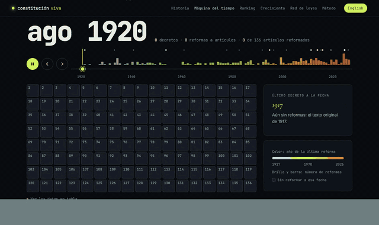
</p>

## Hallazgos

Todas las cifras salen de [`data/`](data/) (Cámara de Diputados al DOF del 07-10-2026; textos de [leyes-mx](https://github.com/BEG-lag/leyes-mx)).

- **285 decretos de reforma, 857 reformas a artículos.** 119 de los 136 artículos se han
  reformado al menos una vez; **17 nunca se han tocado** (8, 9, 12, 23, 39, 47, 50, 57, 64, 68,
  80, 86, 118, 126, 128, 132 y 136).
- **El artículo 73 (facultades del Congreso) se ha reformado 91 veces**, casi el triple que el
  segundo lugar, el 123 (trabajo, 34). Siguen el 27 (tierras, aguas y subsuelo, 24), el 4 (23)
  y el 89 y el 116 (22 cada uno).
- **La mitad de los decretos llegó después del 28 de junio de 1999.** Publicar la primera
  mitad tomó 82 años; la segunda, 27.
- **El ritmo más alto de la historia es el actual.** Desde el 1 de octubre de 2024, 25
  decretos en dos años: 12.4 por año, el doble del récord anterior (Calderón, 6.3 por año).
  2024 es el año con más decretos (15).
- **Los decretos más grandes:** la reforma política de la Ciudad de México (29 de enero de
  2016, 52 artículos), la político-electoral de 2014 que creó el INE (31), la reforma judicial
  de 1994 (27), la judicial de 2024 con jueces electos por voto popular (20) y la electoral de
  1996 (18).
- **El texto no deja de crecer:** unas **20,600 palabras en 1917** (estimado), **44,774 en
  2006** y **75,414 hoy** en los artículos 1 a 136: ×3.7 desde 1917 y +68% desde 2006. El
  artículo 41 (elecciones) pasó de 63 palabras a 4,271; el 123 es hoy el más largo, con 4,819.
- **Un decreto, +4,339 palabras:** la reforma judicial de 2024 es el decreto que más texto
  añadió desde 2006 (y quitó 1,192).
- **La red de leyes:** 209 conexiones de cita entre las 36 leyes, a partir de 821 menciones
  del nombre exacto. 30 de las otras 35 leyes citan la Constitución (27 por su nombre
  completo); los artículos constitucionales más citados son el 27 (34 citas desde 11 leyes) y
  el 123 (25 desde 11). La Ley del Impuesto sobre la Renta y el Código Fiscal de la Federación
  se citan entre sí 104 y 95 veces.

## Qué contiene

<table>
<tr>
<td width="50%">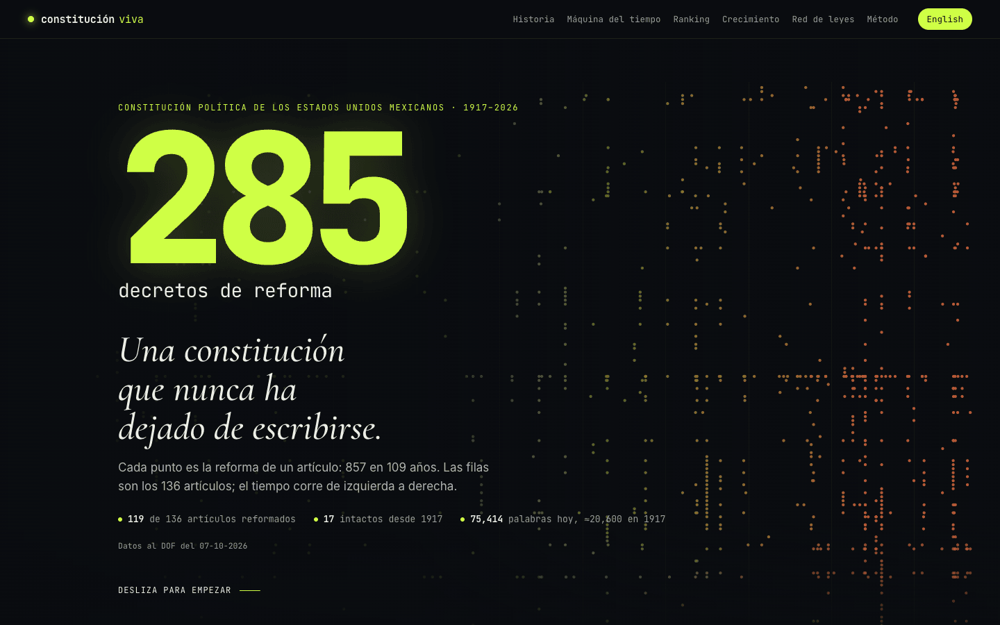</td>
<td width="50%">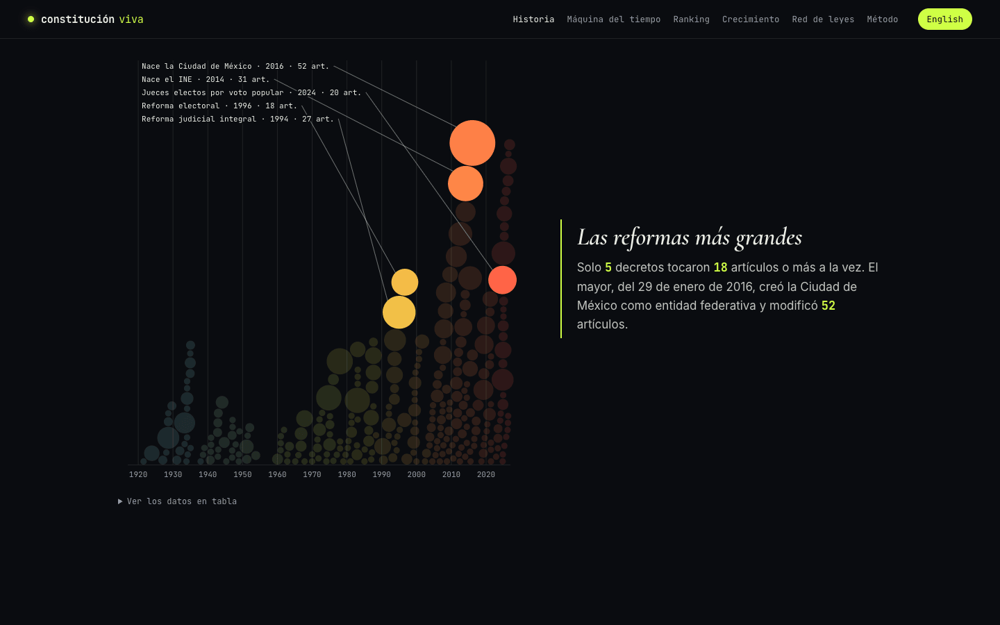</td>
</tr>
<tr>
<td><b>Portada.</b> El total de decretos sobre todo el conjunto de datos en puntos: 857 reformas a artículos; x es el tiempo, y el artículo.</td>
<td><b>Historia.</b> Un enjambre de los 285 decretos guiado por el scroll (tamaño: artículos tocados), de Querétaro en 1917 al ritmo de hoy.</td>
</tr>
<tr>
<td>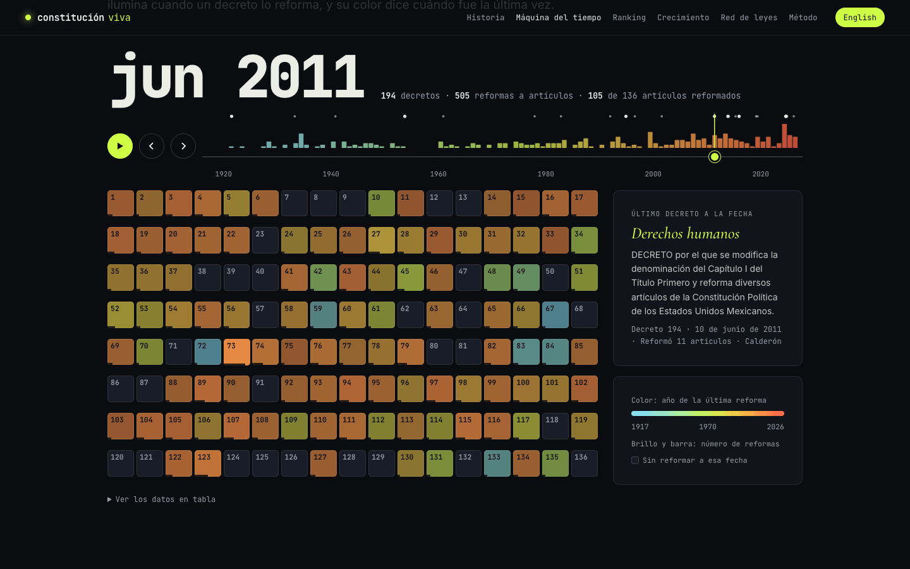</td>
<td>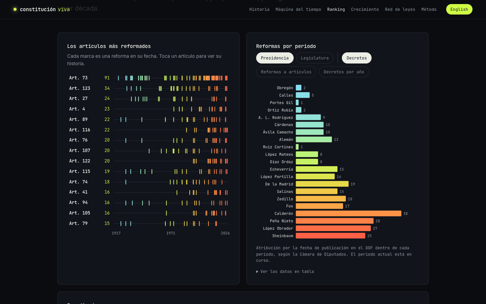</td>
</tr>
<tr>
<td><b>Máquina del tiempo.</b> Arrastra de 1917 a 2026 (o pulsa reproducir): los 136 artículos se encienden cuando un decreto los reforma; los momentos clave se rotulan con el título o el resumen del propio decreto.</td>
<td><b>Ranking.</b> Artículos más reformados, reformas por presidencia o legislatura (decretos, reformas a artículos, decretos por año), por década, un mapa de calor de 136 × 11 y acercamientos a los artículos 73, 27 y 123.</td>
</tr>
<tr>
<td>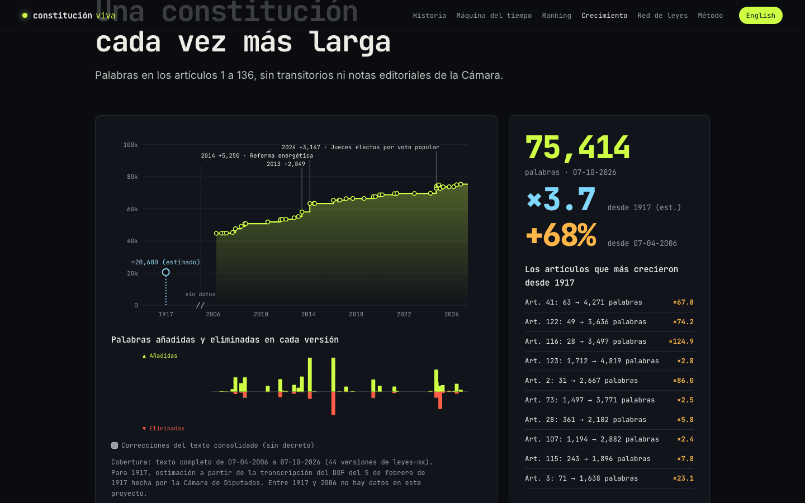</td>
<td>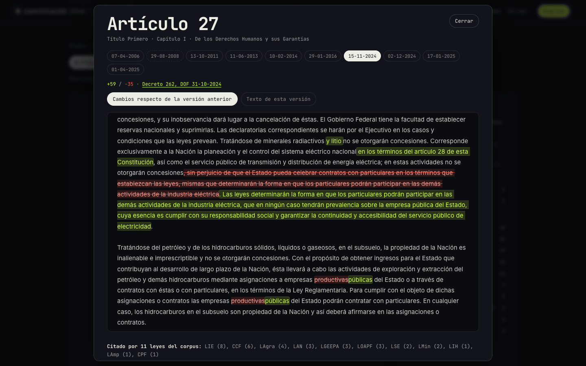</td>
</tr>
<tr>
<td><b>Crecimiento.</b> Extensión de la Constitución por versión desde 2006 (44 versiones), con la estimación de 1917 aparte y «sin datos» en medio; palabras añadidas y eliminadas por versión.</td>
<td><b>Artículo.</b> Cada reforma desde 1917 con ligas al decreto en el DOF y al proceso legislativo, y los cambios reales palabra por palabra entre versiones desde 2006. Liga directa: <code>#art-27</code>.</td>
</tr>
<tr>
<td>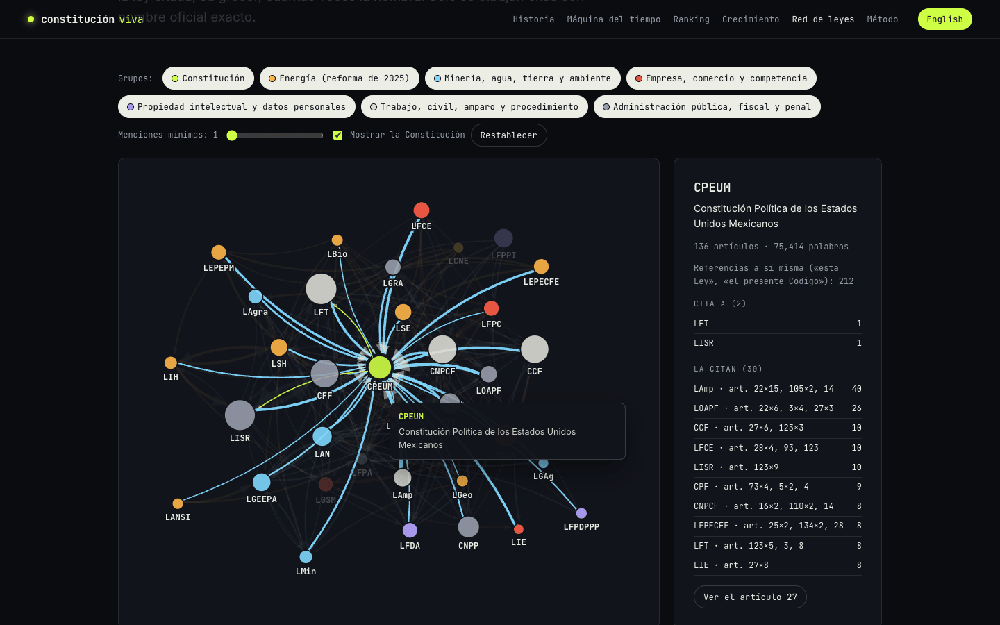</td>
<td>
  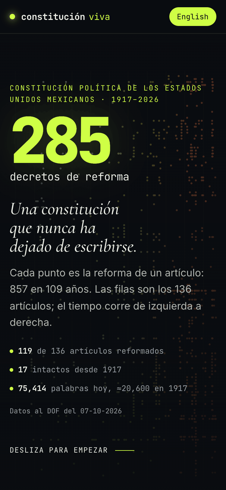
  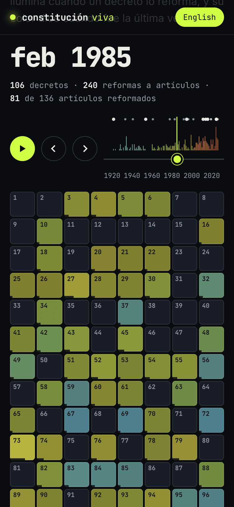
  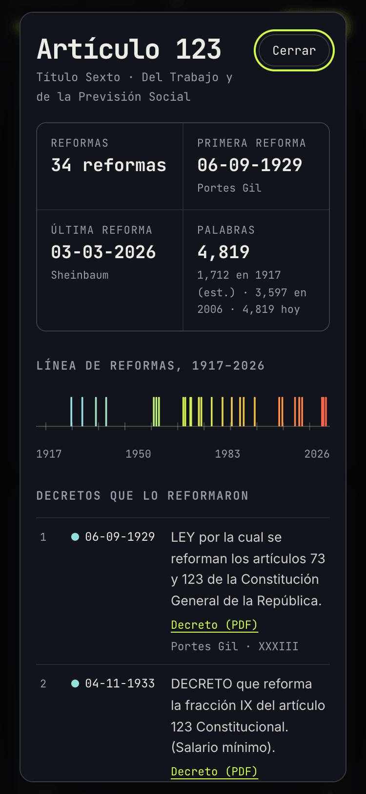
</td>
</tr>
<tr>
<td><b>Red de leyes.</b> Quién cita a quién entre las 36 leyes, con filtros por grupo y menciones mínimas, y los artículos constitucionales que más citan las leyes.</td>
<td><b>Teléfonos.</b> Todo funciona a 375 px sin scroll horizontal.</td>
</tr>
</table>

Accesibilidad: cada gráfica tiene un resumen para lector de pantalla y una tabla de datos; la
máquina del tiempo es un control deslizante nativo con botones; la cuadrícula, los rankings y
los nodos de la red se recorren con el teclado; la vista de artículo es un diálogo modal que
devuelve el foco; `prefers-reduced-motion` apaga animaciones y reproducción automática.

## Cómo se hizo

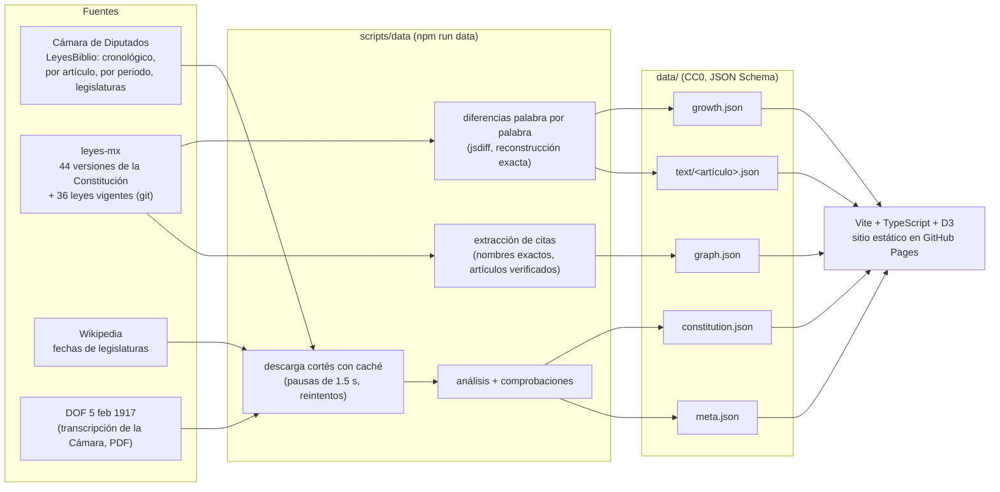

- **Datos.** `npm run data` descarga cada fuente una vez (User-Agent genérico, 1.5 s entre
  solicitudes, reintentos, caché en `.cache/`), clona leyes-mx en `.cache/leyes-mx` y escribe
  `data/`. La generación se detiene si falla cualquier comprobación: numeración y fechas de
  los decretos contra el análisis propio de leyes-mx, cada reforma por artículo contra la
  fecha de su decreto, los años de las legislaturas contra la Cámara, cada momento clave
  contra el título o resumen de su decreto y cada diferencia contra el texto exacto.
  `npm run check:data` valida `data/` contra [`data/schema/`](data/schema/). Ver
  [`data/README.md`](data/README.md), [`docs/metodo.md`](docs/metodo.md) y
  [`docs/fuentes.md`](docs/fuentes.md) (fuentes y fechas de consulta).
- **Sitio.** Vite + TypeScript, módulos de D3 desde npm (sin CDN), tipografías alojadas con
  Fontsource (JetBrains Mono, Inter, Cormorant Garamond). Primera carga: 34 KB de JS y 6 KB de
  CSS comprimidos más 48 KB de datos; crecimiento y red cargan aparte, y la historia de cada
  artículo solo al abrirlo.
- **Comprobaciones.** `npm run check` corre tipos, lint, validación de datos, la revisión de
  guion largo y el build. `npm run screenshots` sirve el build, lo revisa en Chrome sin
  interfaz (sin errores de consola, sin scroll horizontal a 375 px, recorrido con teclado,
  cambio a inglés) y genera las imágenes y el video de arriba.

```bash
npm ci
npm run dev            # http://localhost:5180/constitucion-viva/
npm run data           # regenera data/ desde las fuentes (requiere git y pdftotext de Poppler)
npm run check          # tipos, lint, datos, guion largo, build
npm run screenshots    # revisión sin interfaz + imágenes del README (requiere Google Chrome)
```

## Fuentes y método

| Fuente | Para qué |
|---|---|
| [Reformas en orden cronológico](https://www.diputados.gob.mx/LeyesBiblio/ref/cpeum_crono.htm) | 285 decretos: fecha DOF, título, resumen, ligas |
| [Reformas por artículo](https://www.diputados.gob.mx/LeyesBiblio/ref/cpeum_art.htm) | qué artículos reformó cada decreto |
| [Reformas por periodo presidencial](https://www.diputados.gob.mx/LeyesBiblio/ref/cpeum_per.htm) | periodos presidenciales (fuente oficial) |
| [Wikipedia: legislaturas](https://es.wikipedia.org/wiki/Anexo:Congresos_y_Legislaturas_del_Congreso_de_la_Uni%C3%B3n), contrastada con [la Cámara](https://www.diputados.gob.mx/LeyesBiblio/legis.htm) | fechas de las legislaturas |
| [Texto original de 1917](https://www.diputados.gob.mx/LeyesBiblio/ref/cpeum/CPEUM_orig_05feb1917.pdf) | estimación de extensión en 1917 |
| [leyes-mx](https://github.com/BEG-lag/leyes-mx) | 44 versiones del texto desde 2006, texto vigente de 36 leyes |

Fechas de consulta y SHA-256 de cada fuente: [`docs/fuentes.md`](docs/fuentes.md). Reglas de
extracción y precisión medida: [`docs/metodo.md`](docs/metodo.md).

## Límites

- Un artículo cuenta como reformado por un decreto cuando la Cámara lo lista en «Reformas por
  artículo». Cuánto texto cambió solo se mide desde 2006.
- Este proyecto no tiene el texto completo anterior a 2006. La cifra de 1917 es una
  estimación a partir de la transcripción a tres columnas; en los 17 artículos nunca
  reformados difiere del texto de 2006 en 18 palabras de 770 (2.3%).
- Las versiones de leyes-mx a veces agrupan varios decretos; cada cambio se atribuye a los
  decretos de ese periodo que tocaron el artículo. 65 cambios de artículo no tienen decreto en
  su periodo (correcciones del texto consolidado por la Cámara) y se muestran como editoriales.
- Atribuir una reforma a una presidencia o legislatura por la fecha del DOF es una
  convención: la aprobación involucra al Congreso y a las legislaturas de los estados.
- La red solo ve leyes nombradas por su título oficial exacto (o cuatro alias inequívocos),
  dentro del corpus de 36 leyes.
- La página «Reformas por artículo» de la Cámara lista 857 reformas a los artículos 1 a 136,
  aunque su propio resumen dice 856; se usa la lista detallada.

## Licencia

Código: [MIT](LICENSE). Datos derivados en `data/`: [CC0 1.0](DATA-LICENSE.md). Los textos
legales no son objeto de derecho de autor según el artículo 14, fracción VIII, de la Ley
Federal del Derecho de Autor; es la interpretación del autor, no asesoría legal (ver
[DATA-LICENSE.md](DATA-LICENSE.md)).

## Autor

**Benjamín Esponda García**, abogado corporativo mexicano que construye con IA.
[pivotek.mx](https://pivotek.mx) · [github.com/BEG-lag](https://github.com/BEG-lag)

Relacionado: [leyes-mx](https://github.com/BEG-lag/leyes-mx) (36 leyes federales como código, cada reforma un commit).
