<p align="center">
  <a href="https://pivotek.mx"></a>
</p>

<p align="center">
  
</p>

<p align="center">
  <b>English</b> · <a href="README.es.md">Español</a>
</p>

<p align="center">
  <a href="https://beg-lag.github.io/constitucion-viva/"></a>
  <a href="https://github.com/BEG-lag/constitucion-viva/actions/workflows/ci.yml"></a>
  <a href="LICENSE"></a>
  <a href="DATA-LICENSE.md"></a>
</p>

# constitución viva

**The Mexican Constitution of 1917, alive.** An interactive, data-driven story of
every reform to Mexico's Constitution since 1917: which articles changed, when, under
which presidency and legislature, how the text grew word by word, and how 36 federal
laws cite each other. Spanish first, with an English toggle.

**[Open the experience →](https://beg-lag.github.io/constitucion-viva/)**

> [!IMPORTANT]
> Unofficial. Only the Diario Oficial de la Federación (DOF) is authoritative. Not legal advice.

<p align="center">
  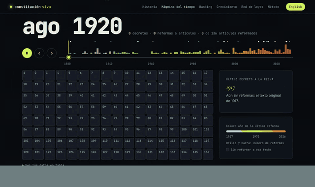
</p>

## Key findings

All numbers come from [`data/`](data/) (Cámara de Diputados as of DOF 07-10-2026; texts from [leyes-mx](https://github.com/BEG-lag/leyes-mx)).

- **285 reform decrees, 857 article reforms.** 119 of the 136 articles have been amended at
  least once; **17 have never been touched** (8, 9, 12, 23, 39, 47, 50, 57, 64, 68, 80, 86,
  118, 126, 128, 132 and 136).
- **Article 73 (the powers of Congress) has been amended 91 times**, almost three times the
  runner-up, article 123 (labor, 34). Then come 27 (land, water and subsoil, 24), 4 (23), and
  89 and 116 (22 each).
- **Half of all decrees came after June 28, 1999.** It took 82 years to publish the first
  half and 27 for the second.
- **The fastest pace ever is today's.** Since October 1, 2024, 25 decrees in two years:
  12.4 a year, twice the previous record (Calderón, 6.3 a year). 2024 is the year with the
  most decrees (15).
- **The largest single decrees:** Mexico City's political reform (January 29, 2016, 52
  articles), the 2014 political-electoral reform that created the INE (31), the 1994 judicial
  overhaul (27), the 2024 judicial reform with judges elected by popular vote (20) and the
  1996 electoral reform (18).
- **The text keeps growing:** about **20,600 words in 1917** (estimate), **44,774 in 2006**
  and **75,414 today** in articles 1 to 136: ×3.7 since 1917 and +68% since 2006. Article 41
  (elections) went from 63 words to 4,271; article 123 is now the longest, at 4,819.
- **One decree, +4,339 words:** the 2024 judicial reform added the most text of any single
  decree since 2006 (and removed 1,192).
- **The web of laws:** 209 directed citation links among the 36 laws, from 821 exact name
  mentions. 30 of the other 35 laws cite the Constitution (27 of them by its full name); the most cited
  constitutional articles are 27 (34 citations from 11 laws) and 123 (25 from 11). The Income
  Tax Law and the Federal Tax Code cite each other 104 and 95 times.

## What's inside

<table>
<tr>
<td width="50%">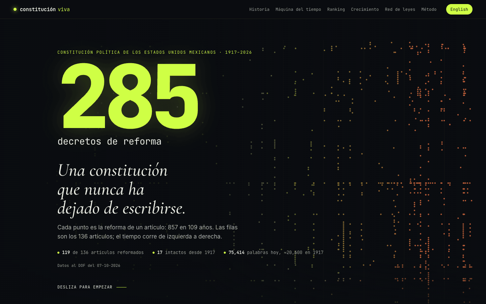</td>
<td width="50%">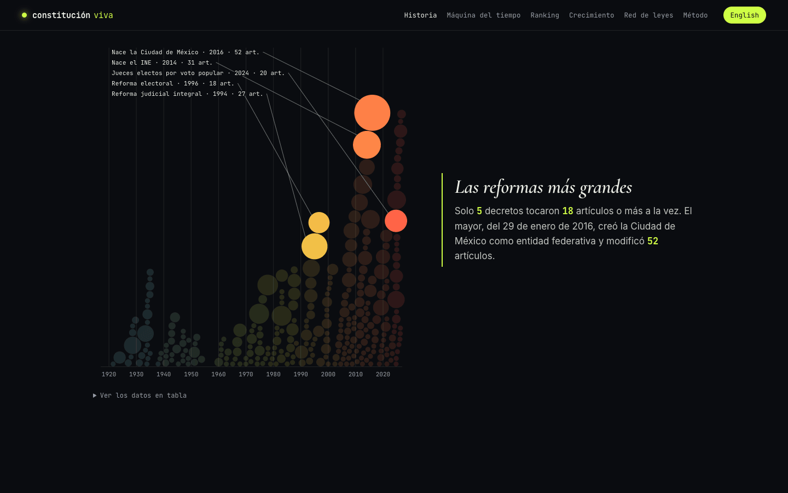</td>
</tr>
<tr>
<td><b>Opening.</b> The count of decrees over the whole dataset as dots: 857 article reforms, x is time, y is the article.</td>
<td><b>Story.</b> A scroll-driven swarm of the 285 decrees (size: articles touched), from Querétaro 1917 to today's pace.</td>
</tr>
<tr>
<td>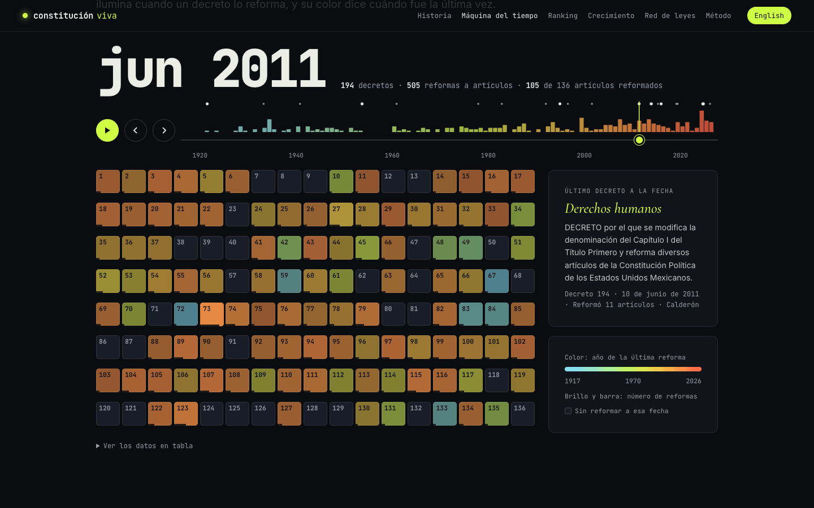</td>
<td>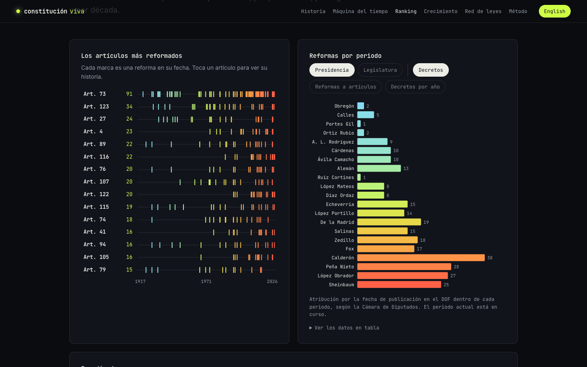</td>
</tr>
<tr>
<td><b>Time machine.</b> Drag from 1917 to 2026 (or press play): the 136 articles light up as decrees amend them; key moments are annotated from the decrees' own titles and summaries.</td>
<td><b>Rankings.</b> Most amended articles, reforms by presidency or legislature (decrees, article reforms, decrees per year), by decade, a 136 × 11 heatmap and close-ups of articles 73, 27 and 123.</td>
</tr>
<tr>
<td>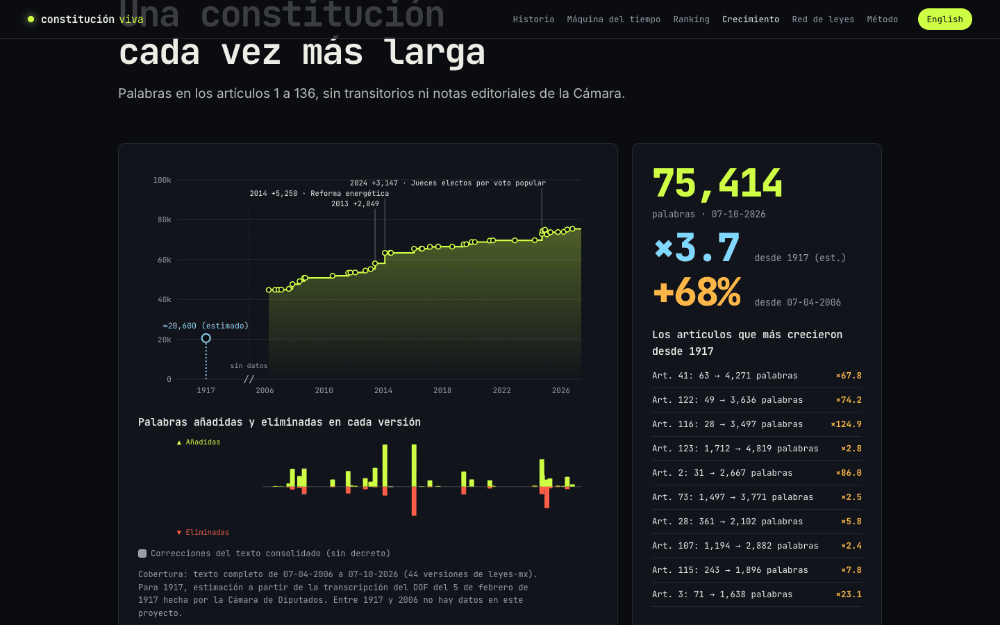</td>
<td>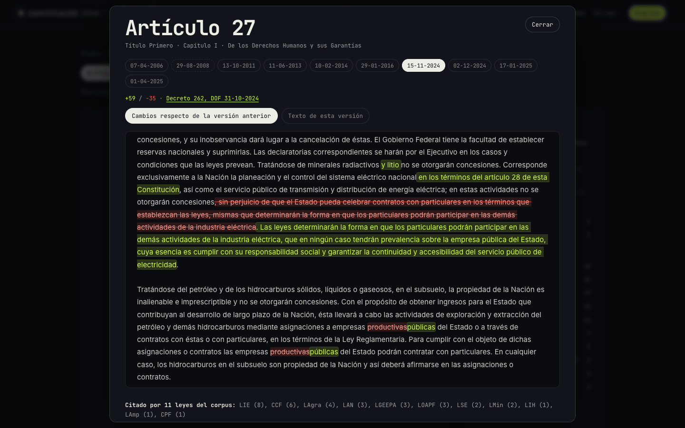</td>
</tr>
<tr>
<td><b>Growth.</b> Length of the Constitution per version since 2006 (44 versions), with the 1917 estimate drawn apart and "no data" in between; words added and removed per version.</td>
<td><b>Article view.</b> Every reform since 1917 with links to the DOF decrees and legislative process, and the actual word-level diff between versions since 2006. Deep links: <code>#art-27</code>.</td>
</tr>
<tr>
<td>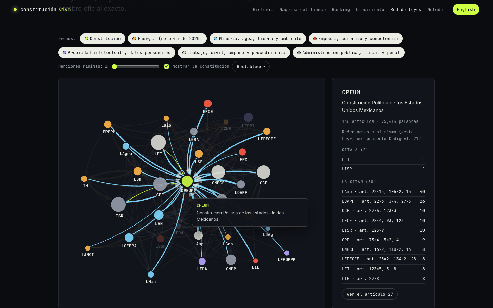</td>
<td>
  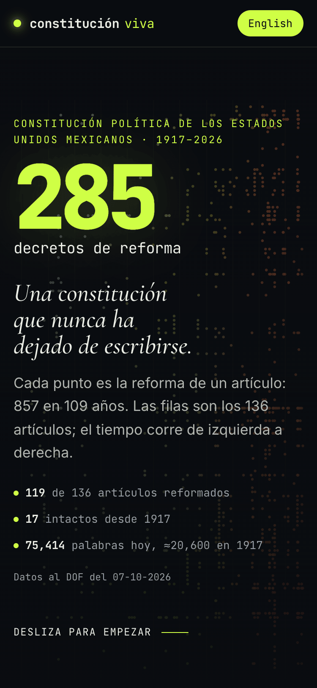
  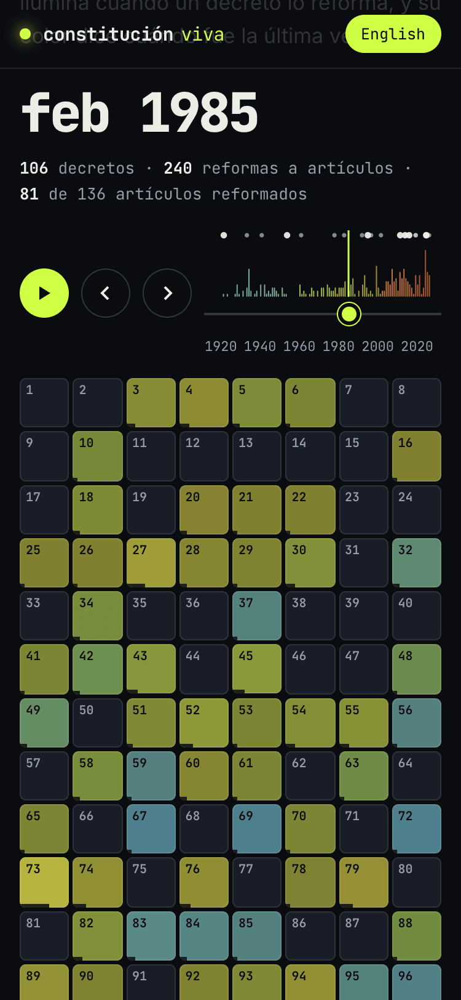
  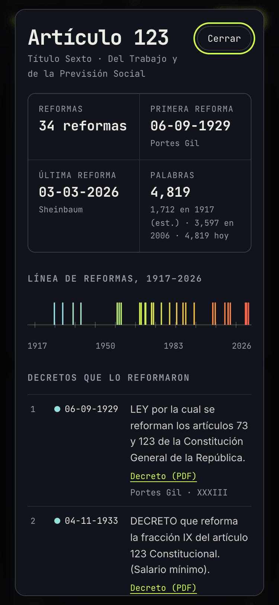
</td>
</tr>
<tr>
<td><b>Web of laws.</b> Who cites whom among the 36 laws, filterable by group and minimum mentions, with the constitutional articles laws cite most.</td>
<td><b>Phones.</b> Every view works at 375 px with no horizontal scroll.</td>
</tr>
</table>

Accessibility: every chart has a screen-reader summary and a data table; the time machine
is a native range input plus buttons; the grid, rankings and graph nodes are keyboard
focusable; the article view is a modal dialog that returns focus; `prefers-reduced-motion`
turns off animation and autoplay.

## How it was built

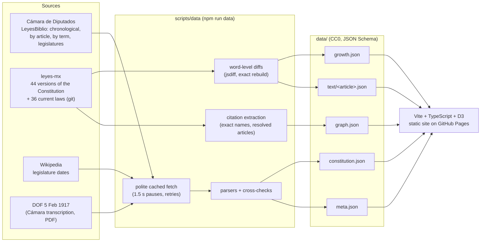

- **Data.** `npm run data` fetches each source once (generic User-Agent, 1.5 s between
  requests, retries, cache in `.cache/`), clones leyes-mx into `.cache/leyes-mx` and writes
  `data/`. The build fails if any cross-check fails: decree numbering and dates against
  leyes-mx's own parse, every article reform matching its decree's date, legislature years
  against the Cámara, every key moment matching its decree's title or summary, and every
  diff rebuilding the exact text. `npm run check:data` validates `data/` against
  [`data/schema/`](data/schema/). See [`data/README.md`](data/README.md),
  [`docs/metodo.md`](docs/metodo.md) and [`docs/fuentes.md`](docs/fuentes.md) (sources and
  retrieval dates).
- **Site.** Vite + TypeScript, D3 modules from npm (no CDN), fonts self-hosted with
  Fontsource (JetBrains Mono, Inter, Cormorant Garamond). First load: 34 KB of JS and 6 KB of
  CSS gzipped plus 48 KB of data; the growth and graph sections load as separate chunks and
  each article's history only when opened.
- **Checks.** `npm run check` runs typecheck, lint, data validation, the em-dash check and
  the build. `npm run screenshots` serves the build, checks it in headless Chrome (no console
  errors, no horizontal scroll at 375 px, keyboard path, English toggle) and captures the
  images and video above.

```bash
npm ci
npm run dev            # http://localhost:5180/constitucion-viva/
npm run data           # rebuild data/ from the sources (needs git and Poppler's pdftotext)
npm run check          # typecheck, lint, data, em-dash, build
npm run screenshots    # headless checks + README images (needs Google Chrome)
```

## Data sources and method

| Source | Used for |
|---|---|
| [Reformas en orden cronológico](https://www.diputados.gob.mx/LeyesBiblio/ref/cpeum_crono.htm) | 285 decrees: DOF date, title, summary, links |
| [Reformas por artículo](https://www.diputados.gob.mx/LeyesBiblio/ref/cpeum_art.htm) | which articles each decree amended |
| [Reformas por periodo presidencial](https://www.diputados.gob.mx/LeyesBiblio/ref/cpeum_per.htm) | presidential terms (official) |
| [Wikipedia: legislatures](https://es.wikipedia.org/wiki/Anexo:Congresos_y_Legislaturas_del_Congreso_de_la_Uni%C3%B3n), checked against [the Cámara](https://www.diputados.gob.mx/LeyesBiblio/legis.htm) | legislature dates |
| [Original text of 1917](https://www.diputados.gob.mx/LeyesBiblio/ref/cpeum/CPEUM_orig_05feb1917.pdf) | 1917 length estimate |
| [leyes-mx](https://github.com/BEG-lag/leyes-mx) | 44 text versions since 2006, current text of 36 laws |

Retrieval dates and SHA-256 of every source: [`docs/fuentes.md`](docs/fuentes.md). Extraction
rules and measured precision: [`docs/metodo.md`](docs/metodo.md).

## Limitations

- An article counts as amended by a decree when the Cámara lists it under "Reformas por
  artículo". How much text changed is only measured from 2006 on.
- There is no full text before 2006 in this project. The 1917 figure is an estimate from the
  three-column transcription; on the 17 never-amended articles it differs from the 2006
  text by 18 words out of 770 (2.3%).
- leyes-mx versions sometimes bundle several decrees; a change is attributed to the decrees
  of that window that touched the article. 65 article changes have no decree in their window
  (corrections of the consolidated text by the Cámara) and are shown as editorial.
- Attributing a reform to a presidency or legislature by DOF date is a convention: approval
  involves Congress and the state legislatures.
- The citation graph only sees laws named by their exact official title (or four
  unambiguous aliases), inside the 36-law corpus.
- The Cámara's by-article page lists 857 reforms to articles 1 to 136, while its own summary
  says 856; the detailed list is used.

## License

Code: [MIT](LICENSE). Derived data in `data/`: [CC0 1.0](DATA-LICENSE.md). The law texts
themselves are not subject to copyright under article 14, fraction VIII, of Mexico's Ley
Federal del Derecho de Autor; that is the author's understanding, not legal advice (see
[DATA-LICENSE.md](DATA-LICENSE.md)).

## Author

**Benjamín Esponda García**, Mexican corporate lawyer who builds with AI.
[pivotek.mx](https://pivotek.mx) · [github.com/BEG-lag](https://github.com/BEG-lag)

Related: [leyes-mx](https://github.com/BEG-lag/leyes-mx) (36 federal laws as code, every reform a commit).
